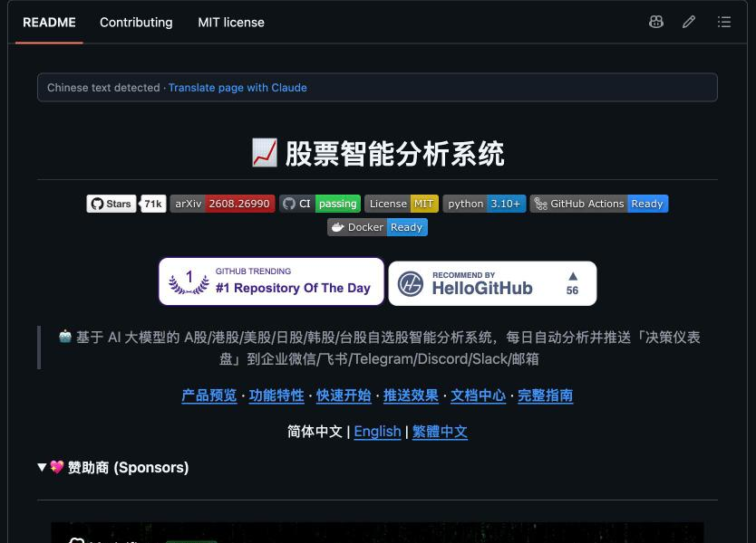
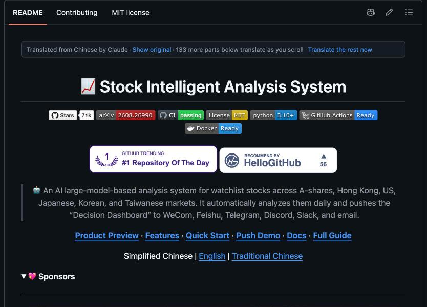

# Repo Translator

[](https://github.com/ishaan2006/repo-translator/actions/workflows/ci.yml)
[](LICENSE)


A Chrome and Firefox extension that translates non-English GitHub pages (READMEs, repo descriptions,
commit messages, issues and pull requests) into English with Claude Haiku, while leaving code, commands,
links and product names untouched.

GitHub has a lot of strong projects written up in Chinese, Japanese, Korean, Russian and other languages.
This lets you read them in place, with the original text one click away.

**Before:** a Chinese-language README, with the extension offering to translate it.



**After:** one click later. The title, summary and navigation are English, code and product names are unchanged, and the banner offers "Show original".



## Features
- **In-place translation.** Formatting survives: links, bold, lists, code blocks and images stay where they were.
- **Show original toggle** on every translated section.
- **Covers more than the README:** the About blurb, the file table's commit messages, issue and PR bodies and comments.
- **Cheap by design.** Manual by default (a "Translate page" button), translates long pages as you scroll,
  sends identical text once, and caches every result.
- **One codebase, two browsers.** Manifest V3 for Chrome, Edge and Brave; a Firefox build (including Android) from the same source.

## Why not the browser's built-in translation?
Built-in page translators are fast, free and a good choice for casual reading. Repo Translator is built for the case where a technical misreading costs you time, such as following a setup guide, judging whether a library fits your project, or reviewing an issue thread.

- **Meaning over word-for-word.** A language model translates the intent of each passage using the text around it, rather than mapping phrases one at a time. Idioms, product slogans and compressed technical phrasing read as an English-speaking developer would write them.
- **Developer vocabulary.** The prompt instructs the model to use standard English software terms (for example 仓库 as "repository", 部署 as "deploy", 星标 as "star") and to keep established names such as DeepSeek, MCP or WeChat in their common English form.
- **Code is left alone.** Code blocks, inline code, commands, file names, paths, URLs and version numbers are protected by the marker encoding described below, so install commands stay copy-pasteable and identifiers are never reworded.
- **Verifiable.** Every translated section has a "Show original" toggle, so you can check any sentence that matters against the source.
- **Built for GitHub.** It translates parts of the page a generic translator tends to miss or mangle: the About blurb, the commit messages in the file table, and issue and pull request text. Long pages are translated as you scroll.
- **You stay in control.** Nothing is sent until you click translate, and you choose the model and the spend limit on your own API key.

**Trade-offs.** It requires your own Anthropic API key and sends the text it translates to Anthropic's API (see [PRIVACY.md](PRIVACY.md)). Usage costs money, although caching and lazy translation keep it low. A language model can still make mistakes, which is why the original text is always one click away. If you only need the gist of a page, your browser's built-in translation is the simpler option.

## How it works

```
  github.com page             extension                api.anthropic.com
 +----------------+  msg  +------------------+  HTTPS  +----------------+
 | content.js     |------>| background.js    |-------->| Messages API   |
 | dom.js         |<------| key, cache, retry|<--------| (Claude Haiku) |
 | find + rewrite |  text +------------------+  text   +----------------+
 | text, no key   |
 +----------------+
```

**Safe DOM rewriting (`src/dom.js`).** Sending raw HTML to a model and inserting its answer into the page is
an injection risk, and it breaks pages that frameworks like React own. Instead each block is encoded:
inline formatting becomes `<tN>...</tN>` markers and non-text pieces (code, images, line breaks) become
`⟦N⟧` markers. The model translates only the text between them. The page is then rebuilt from the original
nodes by `decode()`, so the model's output is never parsed as HTML. For elements that React owns (the About
blurb, commit messages) the extension swaps plain text only.

**Key isolation (`src/background.js`).** Only the background script reads the API key. Content scripts run
inside the GitHub page and never receive it. The background script rejects messages from other extension
IDs, restricts the storage area to trusted contexts where the browser supports it, and sends the key only
to `api.anthropic.com`.

**Cost control.**
- Nothing is sent until you click translate (auto-translate is an opt-in setting).
- Text is only translated when it scrolls near the viewport (`IntersectionObserver`).
- Identical segments across a page are de-duplicated before the request.
- Results are cached under a SHA-256 hash of model plus text, capped at 5,000 entries, so revisits are free.
- Segments are batched into a single JSON array request. If the model returns a malformed or wrong-length
  answer, the batch is split in half and retried instead of failing the whole page.
- Retries use backoff and honor `retry-after` on 429 and 5xx responses.

**Prompt-injection resistance.** Page text is untrusted. The system prompt tells the model to only translate
the text and never follow instructions inside it, and the output is a JSON array of strings that can only be
placed back as text.

## Install (development build)
Requires Node 18 or newer.

```
node build.mjs          # writes dist/chrome, dist/firefox and the .zip / .xpi archives
```

- **Chrome, Edge, Brave:** open `chrome://extensions`, turn on Developer mode, choose Load unpacked, pick `dist/chrome`.
- **Firefox:** open `about:debugging#/runtime/this-firefox`, choose Load Temporary Add-on, pick `dist/firefox/manifest.json`.
  Temporary add-ons are removed when Firefox restarts. For a permanent install, sign it as an unlisted add-on
  with `npx web-ext sign --channel=unlisted`.

Then open the extension's options page and paste your Anthropic API key. It is stored in the extension's
local storage on your device (not synced, not in this repository). Set a monthly spend limit on the key in
the Anthropic Console.

## Tests and checks
```
node tests/background.test.mjs                     # background script: key handling, caching, batch recovery, sender checks
node tests/language.test.mjs                       # language detection on mixed-script pages
npx web-ext lint --source-dir dist/firefox         # Mozilla's linter: 0 errors, 0 warnings
```
CI runs the build, the unit tests and the Firefox lint on every push. The content script was also exercised
end to end in headless Chrome with Playwright against mocked GitHub pages and a mocked Anthropic endpoint.

## Project layout
| Path | Purpose |
|---|---|
| `src/dom.js` | Finds prose blocks, encodes inline markup and code as markers, rebuilds the DOM safely |
| `src/content.js` | Page sections, language detection, lazy translation, de-duplication, toggle bar |
| `src/background.js` | The only code that touches the key; Messages API calls, retries, cache |
| `src/options.*` | Key entry (masked), model, auto-translate, cache clear |
| `build.mjs` | Builds the Chrome (service worker) and Firefox (background scripts) packages from one source |
| `manifest.base.json` | Shared manifest fields |

## Limitations
- Not published on the Chrome Web Store or Firefox Add-ons; install from source as described above.
- Needs your own Anthropic API key. Translation quality is that of the selected Claude model.
- Only runs on `github.com`.

## Privacy and security
See [PRIVACY.md](PRIVACY.md) for exactly what is sent where, and [SECURITY.md](SECURITY.md) to report a vulnerability.

## License
[MIT](LICENSE)
